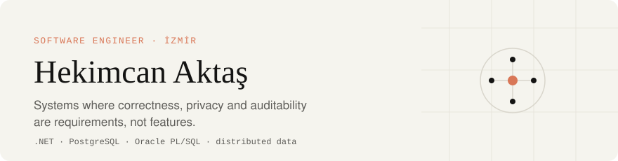

  

I build backend and data systems for places where a wrong answer is expensive: money that must balance,
health records that must stay private, and regulations that must be enforced in code rather than in a policy PDF.

My method is the same in every repository. I name the invariant, find the failure that would break it, prove it holds
with a test against a real database, then measure the cost and write down the trade-off.

  
  

---

### Selected work

<table>
<tr>
<td width="50%" valign="top">

**[ledger-recon](https://github.com/hekimcan206/ledger-recon)** 
PostgreSQL · .NET 10 · FsCheck · NBomber

A double-entry ledger with exactly-once posting and end-of-day reconciliation against card, EFT/FAST and MT940 files.

`50 concurrent duplicates → 1 entry` 
`1,185 RPS · p99 75.9 ms`

</td>
<td width="50%" valign="top">

**[medula-precheck](https://github.com/hekimcan206/medula-precheck)** 
Oracle 23ai · PL/SQL · .NET 10

Healthcare billing rules as versioned, effective-dated code, with a set-based PL/SQL bulk path that matches the .NET engine finding for finding.

`22 rules × 3 versions` 
`byte-identical on 3,000 invoices`

</td>
</tr>
<tr>
<td width="50%" valign="top">

**[kvkk-data-inventory](https://github.com/hekimcan206/kvkk-data-inventory)** 
Oracle · PostgreSQL · KVKK / GDPR

Finds, classifies and masks personal data across two database engines. Masking is keyed and one-way, and preserves checksums.

`F1 0.939 on a labelled schema` 
`2,079 columns scanned in 0.94 s`

</td>
<td width="50%" valign="top">

**[dotnet-service-template](https://github.com/hekimcan206/dotnet-service-template)** 
.NET 10 · OpenTelemetry · Testcontainers

The baseline every service starts from, installed with `dotnet new hekim-service`. It includes analyzers as errors, a chiseled non-root image, CI and CodeQL.

`198 MB image · ready in 10.4 s` 
`93.7% line coverage`

</td>
</tr>
</table>

Every number above comes from a reproducible run. Each repository's <code>docs/benchmarks.md</code> records the hardware, the host load and the method.

---

### Engineering principles

**Invariants live in the database.** Deferred constraint triggers, append-only history and least-privilege roles. Application code is a second line of defence, not the first.

**Tests attack, they don't confirm.** Property-based tests, concurrency races and golden cases all run against real PostgreSQL and Oracle through Testcontainers.

**Numbers or it didn't happen.** A performance claim ships with its benchmark, its environment and its outliers.

**Decisions are written.** Every repository has ADRs listing the options I rejected and why, plus an honest *Limitations* section.

**Privacy is a design input.** Before a schema exists, I decide who can see the data, how long it lives and what trace an access leaves.

---

<b>Currently building</b>

 

| Area | Repositories |
|---|---|
| AI infrastructure | `guarded-db-mcp`, a read-only MCP server for Oracle and PostgreSQL with PII masking and audit · `rag-tr` · `tr-rag-eval` · `oracle23ai-rag` |
| Distributed systems | `offline-pos-sync` · `webhook-relay` · `idempotent-api` · `order-saga-temporal` · `cdc-pipeline` · `outbox-lab` |
| Healthcare & privacy | `patient-feedback-workflow` · `hbys-fhir-bridge` · `sut-rules` · `kvkk-dsar` · `field-crypto` · `merkle-audit` |
| Databases | `ora2pg-verify` · `saas-rls-starter` · `plan-guard` |
| Finance | `fx-bitemporal` · `bank-statement-recon` · `trkarekod` · `ubltr-validator` |
| Reliability | `slo-chaos-lab` · `flags-rollout` · `signalr-scale-lab` |

<b>Toolbox</b>

 

| | |
|---|---|
| **Languages** | C# · SQL · PL/SQL · Python · TypeScript |
| **Backend** | .NET 10, ASP.NET Core, EF Core, Dapper, SignalR, Hangfire, OpenTelemetry |
| **Data** | PostgreSQL · Oracle 23ai · Redis · PostGIS · SQL Server: modelling, query tuning, CDC |
| **Quality** | xUnit v3 · Testcontainers · FsCheck · NBomber · BenchmarkDotNet · Playwright |
| **Platform** | Docker · GitHub Actions · OCI |
| **Certified** | OCI Architect Associate · OCI Foundations Associate · Oracle AI Database Foundations |

---

All repositories use synthetic data only. No employer or customer code, schemas or data appear on this profile.
